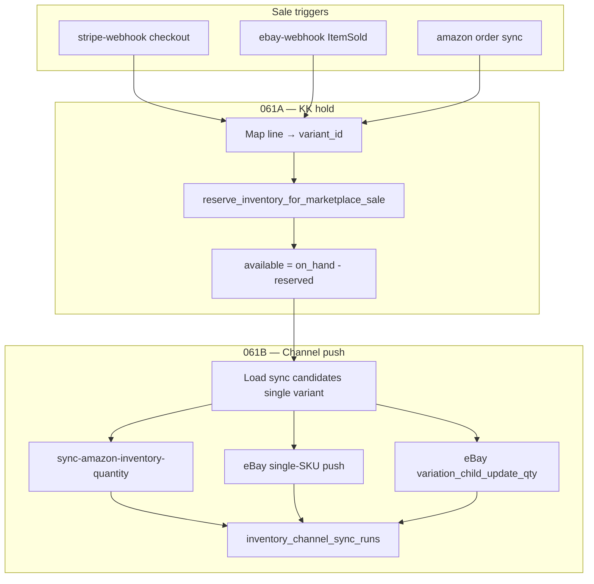

# Phase 061 — Sale-Triggered Channel Sync (Oversell Prevention)

**Status:** ✅ **Complete / Frozen / Production-ready** — **061A ✅** · **061B ✅** · **061C ✅** · Phase 061 frozen at **061C.3**  
**Date:** 2026-06-09 (Phase 061 frozen 2026-06-09)  
**Prerequisite:** Phase 059 complete/frozen, Phase 060 complete/frozen, Phase 6D/6E (KK reserve-only + fulfillment finalize), Phase 7B–7F (channel sync edges), Phase 8D (reservation retry patterns)  
**Triggers:** `stripe-webhook`, `ebay-webhook`, Amazon order sync / import paths  
**Structure:** 3 major phases (061A–061C) × 3 subphases each (.1–.3) = **9 subphases total**

---

## Phase 061 goal

Prevent overselling when the same variant is listed on KK, Amazon FBM, and eBay.

When a committed sale happens on KK, Amazon MFN/FBM, or eBay MFN:

1. KK available qty drops immediately through reservation/hold logic.
2. Other eligible channels receive a best-effort qty push to match current KK available.
3. Duplicate webhooks/order sync retries do not double-reserve or double-push.
4. Channel push failure does not undo the reservation.
5. Phase 059/060 Adjust flows remain frozen.

### Today (gap)

| Event | That platform | KK available | Other channels |
|-------|---------------|--------------|----------------|
| KK sale (paid) | N/A | **↓ immediately** (reservation) | **Unchanged** until manual Adjust/Sync |
| Amazon MFN sale | Amazon ↓ itself | **Unchanged** | **Unchanged** |
| eBay sale | eBay ↓ itself | **Unchanged** | **Unchanged** |

With qty **1** on all three, two marketplace buyers can still purchase before an admin manually syncs.

### Target (Phase 061)

| Event | That platform | KK available | Other channels |
|-------|---------------|--------------|----------------|
| KK sale (paid) | N/A | **↓ immediately** | **Auto-push** to match |
| Amazon MFN sale | Amazon ↓ itself | **↓ immediately** | **Auto-push** (eBay + KK storefront) |
| eBay sale | eBay ↓ itself | **↓ immediately** | **Auto-push** (Amazon + KK storefront) |

**Latency target:** KK/reservation write **< 1s** (same DB transaction as order ingest where possible). Channel push **best-effort async** (typically 5–30s).

---

## Critical guardrails

| Rule | Requirement |
|------|-------------|
| Manual stock writer | `adjust_inventory` remains the **only** manual/admin on-hand stock writer |
| Sale path | Reservation/finalize/release RPCs — **no** ad-hoc stock updates |
| Hold before push | Reservation/hold must succeed **before** any channel push |
| Push failure | Channel push failure **does not** rollback the hold |
| Mapped lines only | Unmapped sale lines → issue/alert — **no** auto-reserve |
| Amazon AFN/FBA | **`afn_skip`** — never push or reserve FBA lines |
| eBay variation | **Child SKU path only** (Phase 060) |
| Qty 0 | Allowed for sale-triggered sync (aligns with post-060D Adjust zero-out) |
| Live gates | `AMAZON_ENABLE_LIVE_PATCH=true`, `EBAY_ENABLE_LIVE_QUANTITY_PATCH=true` |
| Master switch | `SALE_CHANNEL_SYNC_ENABLED=true` for auto-push (061B) |
| Pool safety | No browser snapshot refresh; no full dashboard/issue/returns reads in sale handlers |
| Adjust frozen | Phase 059/060 Adjust UX **unchanged** |
| File size | New JS/TS modules **under 500 lines** where practical |

---

## Phase 061 structure

| Major | Name | Goal |
|-------|------|------|
| **061A** | Sale → KK inventory hold | Mapped paid/unshipped sales reduce **available** immediately |
| **061B** | Hold → cross-channel qty push | Auto-push KK **available** to other eligible channels |
| **061C** | Cancel/restore + final freeze | Release before ship, lightweight visibility, production verify |

---

## Stock mutation policy

**Decision (061A.1):** Reservation-first — not immediate on-hand decrement.

| Channel | On committed sale | On ship | On cancel before ship |
|---------|-------------------|---------|------------------------|
| **KK (Stripe)** | Active reservation (existing reserve-only) | Finalize → decrement on-hand (6E) | Release reservation |
| **Amazon MFN** | Active reservation via new RPC | Finalize on ship confirm / admin ship | Release (061C) |
| **eBay MFN** | Active reservation via new RPC | Finalize on eBay ship / admin ship | Release (061C) |

**Why:** Aligns with KK reserve-only (Phase 6D): **available drops immediately** (`on_hand − reserved`); on-hand decrements at ship.

---

## Architecture (target)



---

## Reuse map (existing assets)

| Capability | Reuse from |
|------------|------------|
| KK checkout reservation | `upsertKkReservation`, `getKkReservationMode` — stripe-webhook |
| Reservation retry pattern | Phase 8D RPC + idempotency keys |
| Fulfillment finalize | `finalize_kk_order_reservations` — extend or parallel for marketplace sessions |
| Amazon qty push | `sync-amazon-inventory-quantity` edge + `inventoryAmazonSyncUtils` |
| eBay single-SKU push | `sync-ebay-inventory-quantity` update_qty mode |
| eBay variation push | `sync-ebay-inventory-quantity` variation_child_update_qty (060) |
| Sync run audit | `inventory_channel_sync_runs` + `inventory_channel_sync_results` |
| Sync context correlation | `parseInventorySyncRunContext` — add `trigger_source=sale`, order/line refs |
| Channel candidates | `v_inventory_channel_sync_candidates`, variation candidate views |
| Adjust orchestrator patterns | `adjustChannelOrchestrator`, eBay variation branch (060) — shared logic only, no UX change |

---

## Progress tracker

| Subphase | Status |
|----------|--------|
| 061A.1 | ✅ Complete |
| 061A.2 | ✅ Complete |
| 061A.3 | ✅ Complete |
| **061A** | **✅ Complete / Frozen** |
| 061B.1 | ✅ Complete |
| 061B.2 | ✅ Complete |
| 061B.3 | ✅ Complete |
| **061B** | **✅ Complete / Frozen** |
| 061C.1 | ✅ Complete |
| 061C.2 | ✅ Complete |
| 061C.3 | ✅ Complete |
| **061C** | **✅ Complete / Frozen** |
| **Phase 061** | **✅ Complete / Frozen / Production-ready** |

---

## 061A — Sale → KK Inventory Hold

**Goal:** Any mapped paid/unshipped sale creates or confirms a KK inventory hold so available qty drops immediately.

KK Stripe path: **verify/enhance** existing reservation — no regression.

### 061A.1 — Audit + design

**Audit:**

- `stripe-webhook`
- `ebay-webhook`
- `ebay-sync-orders`
- Amazon order sync/import paths
- Existing KK reservation/finalize logic
- Line → variant mapping per channel
- Paid/unshipped/canceled/refunded state handling
- Idempotency key format

**Decision:**

- Confirm reservation-first model instead of immediate on-hand decrement.

**Deliverable:**

- 061A audit/design section (this doc, updated at completion)
- Verification script: `scripts/verify-inventory-phase061a1-sale-hold-audit.mjs`

### 061A.1 — Audit findings (completed)

#### Sale ingest paths

| Path | File | Order write | Line write | Reservation today (pre-061A) |
|------|------|-------------|------------|------------------------------|
| **KK Stripe** | `supabase/functions/stripe-webhook/index.ts` | `orders_raw` upsert | `line_items_raw` upsert | `upsertKkReservation` via `stripeWebhookInventory.ts` (reserve-only mode) |
| **eBay webhook** | `supabase/functions/ebay-webhook/index.ts` | insert (dedup skip) | insert per line | None |
| **eBay sync** | `supabase/functions/ebay-sync-orders/index.ts` | insert new orders | insert per line | None |
| **Amazon SP-API** | `supabase/functions/_shared/amazonOrderSyncUtils.ts` | upsert | upsert | None |
| **Amazon cron** | `supabase/functions/amazon-sync-orders-cron/index.ts` | → same util | → same util | None |
| **Amazon TSV import** | `js/admin/lineItemsOrders/amazonImport.js` + RPC | upsert via RPC | upsert via RPC | None (deferred — low priority) |

#### KK reservation path (unchanged in 061A)

- Mode: `inventory_cutover_settings.kk_reservation_mode` → `reserve_only` (Phase 6D)
- Dedup: `inventory_event_dedup` + Stripe event id
- Insert: `upsertKkReservation` → `inventory_reservations` with `channel='kk'`
- Idempotency key: `kk:{order_id}:{order_item_id}:reserve` (legacy — **not migrated** to `sale:kk:…` in 061A)
- Finalize: `finalize_kk_order_reservations` on ship (Phase 6E) — **skips** `ebay_*` / `amazon_*` sessions today
- Refund: `releaseKkActiveReservations` on `charge.refunded`

#### Line → variant mapping

| Channel | Mapping at ingest | 061A resolver |
|---------|-------------------|---------------|
| **KK** | Stripe metadata `kk_variant_id` → `line_items_raw.variant_id` | Existing `upsertKkReservation` (no change) |
| **eBay** | Title fuzzy match → `product_id` (KK code); `variant` = `legacyVariationId`; **no `variant_id`** | `marketplaceSaleHold.ts`: cache SKU / variant SKU / single-variant product fallback |
| **Amazon** | Seller SKU → KK code via `amazon_listing_mappings`; **no `variant_id`** on line | `amazon_listings.seller_sku` → `amazon_listing_mappings.kk_variant_id` |

Admin mapping assist (Phase 8C) can set `line_items_raw.variant_id` — resolver prefers that when present.

#### Order states — qualify vs skip

| State | Qualify for hold | Skip reason |
|-------|------------------|-------------|
| Paid, unshipped MFN | ✅ | — |
| Pending (no payment) | ❌ | Not ingested on KK; eBay/Amazon import without explicit payment filter — hold gated by fulfillment |
| Canceled | ❌ | `canceled_or_refunded` |
| Full refund | ❌ | `canceled_or_refunded` |
| Shipped / FULFILLED | ❌ | `already_shipped` |
| Amazon AFN/FBA | ❌ | `afn_skip` |
| Unmapped line | ❌ | `unmapped_line` → audit `sale_unmapped_no_hold` |
| Duplicate webhook/sync | ✅ idempotent | `already_reserved` |

#### Idempotency key format

**Marketplace (061A):**

```txt
sale:{channel}:{external_order_id}:{external_line_id}:reserve
```

Example: `sale:ebay:ebay_api_12-34567-89012:ebay_li_123456789:reserve`

**KK (legacy, unchanged):**

```txt
kk:{order_id}:{order_item_id}:reserve
```

#### Reservation vs decrement decision

**Confirmed: reservation-first.**

- Sale creates **active** `inventory_reservations` row (`status='reserved'`, `is_shadow=false`)
- **Available** drops immediately: `on_hand − reserved`
- **On-hand** decrements only at finalize/ship (Phase 6E for KK; marketplace finalize deferred)
- **No** `UPDATE product_variants.stock` in 061A
- **No** channel API calls in 061A

#### 061A hook points (implemented)

| Path | Hook | Guards |
|------|------|--------|
| eBay webhook | `insertEbayOrder()` after shipment upsert | Not canceled; `applyEbaySaleHoldsAfterIngest` |
| eBay sync | After new-order shipment upsert | `!isCanceled` |
| Amazon sync | After line + shipment upsert | `!isCanceled`; order-level AFN/shipped skip |
| KK Stripe | **No change** — existing `upsertKkReservation` loop | Verified only |

**Failure handling:** Order ingest never fails on hold failure; RPC returns structured skip/fail; audit in `inventory_sale_hold_actions`.

**061B note:** No channel push, no `SALE_CHANNEL_SYNC_ENABLED`, no sale sync orchestrator exists yet.

### 061A.2 — Reservation RPC + trigger wiring ✅

Implement/extend reservation RPC: `reserve_inventory_for_marketplace_sale`

**Inputs:**

- channel
- external order id
- external line id
- variant_id
- qty
- idempotency key

**Rules:**

- Active reservation only
- No channel APIs
- No stock decrement
- Idempotent
- Non-fatal on failure, but logs issue

**Wire:**

- eBay order ingest
- Amazon MFN order ingest
- Confirm KK Stripe reservation path

### 061A.3 — Hold verification + freeze ✅

**Verify:**

- Mapped sale reserves once
- Duplicate webhook does not double-reserve
- Unmapped sale creates issue and skips
- AFN/FBA skips
- qty > 1 works
- Multi-line order works
- Cancel/refund paths **not** handled yet
- **No channel push yet**

**Freeze 061A.**

Verification script: `scripts/verify-inventory-phase061a3-sale-hold-matrix.mjs`

---

## 061B — Hold → Cross-Channel Qty Push

**Goal:** After a successful hold, automatically push current KK available qty to other eligible channels.

## 061B — Hold → Cross-Channel Qty Push

**Goal:** After a successful hold, automatically push current KK available qty to other eligible channels.

**Production prerequisite:** Phase 060 qty/relist paths should pass `verify-inventory-phase060-final-freeze.mjs` full nested compose before enabling live sale-triggered push. A separate run of that script reported 2 composed sub-check failures — resolve before production live push; 061B design does not depend on fixing that in 061B.1.

### 061B.1 — Sale sync orchestrator design ✅

**Status:** Design-only — no runtime push wiring in this subphase.

#### 061B.1 audit findings — reusable push assets

**Amazon (Phase 059B)**

| Asset | Path | Sale-push reuse |
|-------|------|-----------------|
| Qty edge | `supabase/functions/sync-amazon-inventory-quantity/index.ts` | `mode: update_qty`, `variantIds: [id]`, `limit: 1` |
| Shared utils | `supabase/functions/_shared/inventoryAmazonSyncUtils.ts` | `loadAmazonSyncCandidates`, `parseInventorySyncRunContext`, `targetQtyFromAvailable` |
| Inactive restock | same edge, `mode: inactive_restock` | **Out of 061B sale push** — sale sync pushes **current available** only; inactive restore is Adjust/manual workflow |
| Live gate | `AMAZON_ENABLE_LIVE_PATCH=true` | Required for live patch; else `preview:true` → dry_run |
| AFN skip | Candidate view + edge filters | Amazon target must be FBM-mapped; AFN lines never reach sale push |

**eBay (Phase 059C + 060A)**

| Asset | Path | Sale-push reuse |
|-------|------|-----------------|
| Qty edge | `supabase/functions/sync-ebay-inventory-quantity/index.ts` | `mode: update_qty` (single-SKU) or `variation_child_update_qty` (060A) |
| Single-SKU utils | `supabase/functions/_shared/inventoryEbaySyncUtils.ts` | `loadEbaySyncCandidates`, `ENDED_STATUSES` — ended → skip/manual, **no relist from sale** |
| Variation loaders | `supabase/functions/_shared/ebayVariationChildCandidateLoaders.ts` | `loadVariationChildCandidateForVariant` — narrow single-variant read |
| Variation utils | `supabase/functions/_shared/inventoryEbayVariationSyncUtils.ts` | Qty resolution, gate checks |
| Relist edges | `relist-ebay-from-product`, `relist-ebay-variation-group` | **Explicitly out of 061B** — sale sync does not relist ended listings |
| Live gate | `EBAY_ENABLE_LIVE_QUANTITY_PATCH=true` | Required for live qty patch |
| Cache missing | `variation_qty_cache_missing` / `ebay_qty_cache_missing` | Skip or dry_run + issue; optional cache refresh is **not** in 061B.1 scope |

**Phase 059/060 Adjust orchestration (reference only — do not modify)**

| Asset | Path | Pattern to mirror |
|-------|------|-------------------|
| Orchestrator | `js/admin/inventory/services/adjustChannelOrchestrator.js` | Branch order: KK adjust first → channel pushes; sale orchestrator **skips adjust** |
| eBay branch | `js/admin/inventory/services/adjustChannelEbayBranch.js` | Variation listing routes to variation branch **before** single-SKU `update_qty` |
| Variation branch | `js/admin/inventory/services/adjustChannelEbayVariationBranch.js` | `variation_child_update_qty` for active child; relist states **ignored** in sale push |
| Sync context | `js/admin/inventory/services/adjustSyncContext.js` | `trigger_source: manual_adjust` → sale uses `trigger_source: sale` |
| Candidate API (browser) | `js/admin/inventory/api/channelSyncCandidateApi.js` | Single-variant `v_inventory_channel_sync_candidates` read — **browser only**; sale orchestrator uses edge `_shared` loaders |

**Candidate views (server-side reads)**

| View | Use in sale push |
|------|------------------|
| `v_inventory_channel_sync_candidates` | Amazon FBM + single-SKU eBay eligibility, `amazon_sync_action`, `ebay_sync_action` |
| `v_inventory_ebay_variation_sync_candidates` | Active variation child qty when `ebay_item_group_key` + multi-variant |

**061A (hold — prerequisite)**

| Asset | Path | Role |
|-------|------|------|
| Hold helper | `supabase/functions/_shared/marketplaceSaleHold.ts` | Emits hold batch; 061B wires **after** `reserved: true` |
| Hold RPC | `reserve_inventory_for_marketplace_sale` | Returns `{ reserved, skipped_reason, reservation_id, idempotency_key, audit_id }` |
| Hold audit | `inventory_sale_hold_actions` | `holdActionId` = `audit_id`; link via `syncContext.stock_reservation_id` |
| Hold idempotency | `sale:{channel}:{order_id}:{line_id}:reserve` | Separate from push keys |

#### Orchestrator contract (proposed module)

**Path (061B.2):** `supabase/functions/_shared/saleChannelSyncOrchestrator.ts`

**Input:**

```ts
{
  sourceChannel: "kk" | "amazon" | "ebay";
  productId: string;
  variantId: string;
  availableQty: number;          // KK available after hold (may be 0)
  externalOrderId: string;
  externalLineId: string;
  holdActionId?: string;         // inventory_sale_hold_actions.id
  reservationId?: string;
  idempotencyKey: string;      // sale push base key (see idempotency)
  preview?: boolean;             // force dry_run paths
  syncContext?: {
    trigger_source: "sale";
    trigger_reference_type: "order_line";
    trigger_reference_id: string;  // `${externalOrderId}:${externalLineId}`
    stock_reservation_id?: string;
    orchestration_id?: string;
  };
}
```

**Output:**

```ts
{
  status: "success" | "dry_run" | "partial" | "skipped" | "failed";
  sourceChannel: string;
  variantId: string;
  availableQty: number;
  results: Array<{
    channel: "amazon" | "ebay";
    path: string;               // e.g. amazon_update_qty, ebay_update_qty, ebay_variation_child_update_qty
    status: "success" | "dry_run" | "skipped" | "manual" | "failed";
    message: string;
    runId?: string;
    errors?: string[];
    warnings?: string[];
  }>;
  idempotencyKey: string;
}
```

**Preconditions (orchestrator entry):**

1. `SALE_CHANNEL_SYNC_ENABLED=true` — else `status: skipped`, audit `sale_sync_disabled`
2. Hold succeeded (`reservationId` present OR KK legacy reservation confirmed) — else do not invoke
3. `availableQty >= 0` (0 allowed)
4. Never call `adjust_inventory` or `UPDATE product_variants.stock`

#### Channel selection rules

| sourceChannel | Target channels | Notes |
|---------------|-----------------|-------|
| `kk` | Amazon + eBay | Both targets evaluated independently |
| `amazon` | eBay only | KK availability already reduced by reservation; **no** KK storefront API in 061B |
| `ebay` | Amazon only | Same — reservation handles KK |

**Never push back to source channel** in 061B (no reconciliation mode).

**Amazon target path:**

- Load single variant from `v_inventory_channel_sync_candidates`
- Require `amazon_sync_action` in (`update_qty`, qty mismatch states) — **not** `inactive_restock` / AFN
- Push `targetQty = availableQty` (including 0)
- Skip/manual if unmapped, AFN, or `manual_review` states

**eBay target path (exactly one path per variant):**

```
1. If variation listing (ebay_item_group_key + product_active_variant_count > 1):
     → load v_inventory_ebay_variation_sync_candidates
     → if candidate_state = variation_update_qty (or cache_missing with refresh policy in 061B.2):
         path = variation_child_update_qty
     → elif manual/mapping/ended states: skip/manual (no relist)
2. Else single-SKU:
     → load v_inventory_channel_sync_candidates
     → if ebay_sync_action = update_qty: path = update_qty
     → if ended_needs_relist: skip/manual (relist stays Adjust-only)
3. Never invoke relist-ebay-from-product or relist-ebay-variation-group from sale sync
```

**Qty 0:** Allowed on all target paths (aligns with Phase 060D Adjust zero-out).

#### Candidate loading strategy (narrow reads only)

| Target | Loader | Max scope |
|--------|--------|-----------|
| Amazon | `loadAmazonSyncCandidates({ variantIds: [variantId], limit: 1 })` | One row |
| eBay single-SKU | `loadEbaySyncCandidates({ variantIds: [variantId], limit: 1 })` | One row |
| eBay variation | `loadVariationChildCandidateForVariant(client, productId, variantId)` | One child row |

**Forbidden in sale orchestrator:**

- `fetchChannelSyncPreview()` (full catalog)
- `refreshIssueSnapshot` / dashboard issue reads
- Browser `channelSyncCandidateApi.js` (edge uses `_shared` loaders with service role)

**availableQty source:** Re-read `v_inventory_channel_sync_candidates.available_qty` for variant at push time (or trust caller's post-hold value if within same second — 061B.2 should re-read for safety).

#### Idempotency design

**Hold key (061A, unchanged):**

```txt
sale:{channel}:{external_order_id}:{external_line_id}:reserve
```

**Push keys (061B):**

Base:

```txt
sale:{source_channel}:{external_order_id}:{external_line_id}:push
```

Per target channel (recommended for partial retry):

```txt
sale:{source_channel}:{external_order_id}:{external_line_id}:push:amazon
sale:{source_channel}:{external_order_id}:{external_line_id}:push:ebay
```

**Storage:**

| Layer | Table | Purpose |
|-------|-------|---------|
| Push idempotency | `inventory_channel_sync_runs` | Existing run audit; dedupe via `orchestration_id` = push base key OR unique constraint on `(trigger_source, trigger_reference_id, channel)` |
| Per-result | `inventory_channel_sync_results` | Per-target outcome |
| Sale-specific audit (optional 061B.2) | `inventory_sale_sync_actions` | Mirror `inventory_sale_hold_actions` pattern — enqueue status, skip reason, run_ids |
| Queue (Option B) | `inventory_sale_sync_queue` | New table in 061B.2 migration |

**Retry rules:**

- Duplicate webhook/sync: same push key → skip with `already_pushed` (read existing run)
- Failed push: allow retry with same key only if prior run `status=failed` (no successful partial)
- `dry_run`: audit once per key; do not treat as live push success

#### Option A vs Option B — runtime decision

| | Option A — fire-and-forget edge invoke | Option B — lightweight queue + worker |
|--|----------------------------------------|-------------------------------------|
| Latency | Lower (~seconds) | Higher (~30s cron/worker) |
| Webhook safety | Adds edge load to ingest path | Ingest only inserts queue row |
| Idempotency | Relies on run-table dedupe | Queue `status` + unique key |
| Retry | Manual re-invoke or issue assist | Worker retries failed rows |
| Pool pressure | Risk under webhook bursts | Decoupled |

**Decision for 061B.2: Option B (lightweight queue).**

**Why:** eBay/Amazon webhooks and order sync already do DB work + 061A hold. Adding synchronous edge invokes (2× channel edges per line) increases pool exhaustion risk (Phase 10Y lesson). A small `inventory_sale_sync_queue` table + existing cron pattern (or dedicated `process-sale-sync-queue` edge on schedule) gives safer retry, visibility, and non-fatal ingest.

**Option A fallback:** If queue migration is blocked, 061B.2 may use async `fetch()` fire-and-forget to a dedicated `process-sale-sync` edge **after** queue insert fails — document as degraded mode only.

**061B.2 implements:** queue table + worker edge; **no** wiring to all sale triggers until 061B.3.

#### Failure and issue handling

| Condition | Reservation | Push | Issue / audit |
|-----------|-------------|------|---------------|
| Hold failed | N/A | Do not enqueue | `sale_unmapped_no_hold` (061A) |
| `SALE_CHANNEL_SYNC_ENABLED=false` | Kept | Skip | `sale_sync_disabled` |
| Live gate off | Kept | `dry_run` | `sale_sync_gate_off` |
| Mapping manual/ambiguous | Kept | Skip target | `sale_sync_mapping_manual` |
| Edge push failed | **Kept — no rollback** | `failed` | `sale_sync_push_failed` |
| Partial (one channel ok) | Kept | `partial` | Per-channel results |

Push failure **never** releases reservation or decrements stock.

#### 061B.2 — Queue + orchestrator runtime ✅

**061B.2 scope:** queue table + worker edge + orchestrator runtime (no sale trigger wiring until 061B.3).

**Status:** Runtime implemented — **no sale trigger wiring** (061B.3).

##### Queue schema — `inventory_sale_sync_queue`

Migration: `supabase/migrations/20261028_inventory_phase061b2_sale_sync_queue.sql`

| Column | Purpose |
|--------|---------|
| `push_idempotency_key` | Unique — `sale:{source}:{order}:{line}:push` |
| `source_channel` | `kk` \| `amazon` \| `ebay` |
| `target_channels` | Derived target list at enqueue |
| `variant_id`, `available_qty` | Push scope (qty ≥ 0, **0 allowed**) |
| `reservation_id`, `hold_action_id` | Link to 061A hold |
| `status` | `pending` → `processing` → terminal states |
| `attempt_count`, `max_attempts` | Retry with backoff; `dead` after max |
| `sync_context`, `last_result` | Audit / orchestrator output |

Claim RPC: `claim_inventory_sale_sync_jobs(limit, worker_id)` — `FOR UPDATE SKIP LOCKED`.

##### Runtime modules

| Module | Role |
|--------|------|
| `saleSyncQueue.ts` | Enqueue (idempotent), claim, mark result + retry |
| `saleChannelSyncTypes.ts` | Types, target rules, idempotency keys, status aggregation |
| `saleChannelSyncOrchestrator.ts` | Master switch, orchestrate targets |
| `saleChannelSyncAmazonTarget.ts` | FBM `update_qty` via shared utils; AFN skip |
| `saleChannelSyncEbayTarget.ts` | Variation child OR single-SKU; no relist |

##### Worker — `process-sale-channel-sync-queue`

- Auth: `CRON_SECRET` or admin JWT
- Claims jobs → `runSaleChannelSync` → marks queue row
- **Default `preview: true`** unless `preview: false` and live gates on
- No webhook/sale ingest wiring

##### Manual test enqueue — `enqueue-sale-channel-sync`

- Admin-only test enqueue (not wired to sale triggers)
- Metadata: `enqueue_mode: manual_test_061b2`

##### Idempotency + retry

- Enqueue: unique `push_idempotency_key` → `already_queued` on duplicate
- Per-target keys available: `…:push:amazon`, `…:push:ebay`
- Sync runs: `inventory_channel_sync_runs` with `trigger_source: sale`
- Failed jobs: backoff 30s→600s, then `dead`
- **No reservation rollback on push failure**

##### Dry-run / live gate behavior

| Condition | Behavior |
|-----------|----------|
| `SALE_CHANNEL_SYNC_ENABLED !== true` | Orchestrator `skipped` (`sale_sync_disabled`) |
| `AMAZON_ENABLE_LIVE_PATCH` off | Amazon target `dry_run` (`sale_sync_gate_off`) |
| `EBAY_ENABLE_LIVE_QUANTITY_PATCH` off | eBay target `dry_run` (`sale_sync_gate_off`) |
| Worker `preview: true` (default) | Forces dry_run paths |

##### Mocked runtime matrix (static verify)

| Case | Expected |
|------|----------|
| Duplicate enqueue key | One queue row |
| Master switch off | `skipped` |
| KK source | Amazon + eBay targets |
| Amazon source | eBay only |
| eBay source | Amazon only |
| `availableQty = 0` | Allowed |
| Variation listing | `variation_child_update_qty` path |
| Single-SKU | `update_qty` path |
| Ended eBay / mapping manual | `manual` skip |
| Push failure | Job retry/dead; reservation untouched |

Verification: `scripts/verify-inventory-phase061b2-sale-sync-queue-worker.mjs`

**Safety confirmations (061B.2):**

- No sale trigger wiring on stripe/eBay/Amazon ingest
- No `adjust_inventory` / no direct stock UPDATE
- No `relist-ebay-variation-group` / `relist-ebay-from-product`
- No `fetchChannelSyncPreview` / no snapshot refresh
- Phase 060 full freeze should be green before **production live** sale push

#### 061B.3 — Wire sale triggers + freeze ✅

**Status:** Complete — sale paths enqueue after successful hold; no inline marketplace push.

##### Trigger wiring summary

| Sale path | File | Enqueue trigger |
|-----------|------|-----------------|
| **KK Stripe** | `stripe-webhook/index.ts` | After `upsertKkReservation` (`inserted` or idempotent `skipped`) → `enqueueSaleSyncAfterSuccessfulHold` with `sourceChannel: kk` |
| **eBay webhook** | `ebay-webhook/index.ts` | Via `applyEbaySaleHoldsAfterIngest` → `enqueueSaleSyncForHoldBatch` |
| **eBay sync** | `ebay-sync-orders/index.ts` | Via `applyEbaySaleHoldsAfterIngest` → `enqueueSaleSyncForHoldBatch` |
| **Amazon sync** | `amazonOrderSyncUtils.ts` | Via `applyAmazonSaleHoldsAfterIngest` → `enqueueSaleSyncForHoldBatch` |

Shared helper: `supabase/functions/_shared/marketplaceSaleSyncAfterHold.ts`

##### Enqueue-after-hold rules

- Enqueue **only** when hold means reservation created (`reserved: true`) or safely idempotent (`already_reserved` + `reservation_id`).
- **Do not enqueue** when hold skipped: `unmapped_line`, `invalid_qty`, `afn_skip`, `canceled_or_refunded`, `already_shipped`, `sale_hold_failed`.
- No marketplace calls in enqueue helper; no worker processing inline; no stock writes.
- Push failure does **not** undo reservation.

##### availableQty after hold

- Read `v_inventory_channel_sync_candidates.available_qty` for variant (on_hand − active reservations).
- Fallback: `product_variants.stock` minus active non-shadow `inventory_reservations`.
- `availableQty = 0` allowed.
- If unavailable: skip enqueue, log `sale_sync_available_qty_unknown`.

##### Idempotency

- Push key: `sale:{sourceChannel}:{external_order_id}:{external_line_id}:push`
- Duplicate webhook/sync → `already_queued` (unique `push_idempotency_key`); no duplicate queue row.

##### syncContext on enqueue

```json
{
  "trigger_source": "sale",
  "trigger_reference_type": "order_line",
  "trigger_reference_id": "{order_id}:{line_id}",
  "stock_reservation_id": "{reservation_id}",
  "orchestration_id": "{push_idempotency_key}"
}
```

##### Source-channel target behavior (worker)

| Source | Targets |
|--------|---------|
| `kk` | Amazon + eBay |
| `amazon` | eBay only |
| `ebay` | Amazon only |

Amazon AFN/FBA skip preserved in target helper. eBay ended-listing relist and variation-group relist **not** run from sale sync.

##### Mocked end-to-end matrix (verification — no live calls)

| Case | Expected |
|------|----------|
| KK mapped sale hold succeeds | Enqueue `kk` → worker targets Amazon + eBay |
| KK availableQty 0 | Enqueue with qty 0; worker dry_run/push 0 |
| eBay mapped sale hold succeeds | Enqueue `ebay` → worker targets Amazon only |
| Duplicate eBay webhook | One queue row (idempotent key) |
| Amazon MFN hold succeeds | Enqueue `amazon` → worker targets eBay only |
| Amazon AFN/FBA | Hold skip `afn_skip` → no enqueue |
| Duplicate Amazon sync | One queue row |
| Hold fails | No enqueue |
| Worker target fails | Reservation remains; job retries/dead |
| `SALE_CHANNEL_SYNC_ENABLED` off | Orchestrator `skipped` |
| Live gates off | Target `dry_run` (`sale_sync_gate_off`) |

Verification: `scripts/verify-inventory-phase061b-sale-push.mjs`  
Final freeze: `scripts/verify-inventory-phase061b-final-freeze.mjs`

##### Safety confirmations (061B.3)

- No inline `sync-amazon-inventory-quantity` / `sync-ebay-inventory-quantity` in sale paths
- No `adjust_inventory` / no direct `UPDATE product_variants.stock`
- No `fetchChannelSyncPreview` / no browser snapshot refresh
- No Adjust UX/runtime changes
- Phase 059/060 remain frozen

##### Deployment notes (061B)

1. Apply migrations: `20261027_inventory_phase061a_sale_hold_reservations.sql`, `20261028_inventory_phase061b2_sale_sync_queue.sql`
2. Deploy edges: `stripe-webhook`, `ebay-webhook`, `ebay-sync-orders`, Amazon order sync, `process-sale-channel-sync-queue`, `enqueue-sale-channel-sync` (manual test)
3. Set `SALE_CHANNEL_SYNC_ENABLED=false` initially
4. Run worker with `preview: true` first (dry_run)
5. Set `AMAZON_ENABLE_LIVE_PATCH` / `EBAY_ENABLE_LIVE_QUANTITY_PATCH` explicitly before live pilot
6. Pilot SKU (e.g. KK-0001 Black); enable master switch after pilot check

#### 061B.3 scope (wire + freeze) — ✅ complete

- ~~After successful hold: enqueue sale sync row~~ **Done** via `marketplaceSaleSyncAfterHold.ts`
- ~~KK Stripe path~~ **Done**
- ~~Verify matrix~~ **Done** — `verify-inventory-phase061b-sale-push.mjs`
- **061B frozen**

### 061B.3 — Push verification + freeze ✅

**Verified:**

- KK sale → enqueue → Amazon/eBay qty push (async worker)
- Amazon sale → KK hold + eBay push enqueue
- eBay sale → KK hold + Amazon push enqueue
- qty 0 allowed
- Live gates off → dry_run
- Push failure does not undo reservation
- Duplicate sale push idempotent
- No Adjust flow regression
- No live calls in verification

**061B frozen.**

Verification script: `scripts/verify-inventory-phase061b-sale-push.mjs`

---

## 061C — Cancel/Restore + Final Phase Freeze

**Goal:** Handle sale unwind before ship, then freeze Phase 061.

### 061C.1 — Cancel/refund release path ✅

**Status:** Complete — active sale reservations released on cancel/refund before ship. **Channel re-push after release deferred to 061C.2.**

#### Cancel/refund audit findings

| Channel | Path | Pre-061C.1 behavior | Gap |
|---------|------|---------------------|-----|
| **KK Stripe** | `charge.refunded` → `stripeWebhookChargeRefunded.ts` | Full refund in `reserve_only` mode called `releaseKkActiveReservations` (direct `UPDATE`, order-level) | No RPC audit; no per-line idempotency; partial refund ignored |
| **eBay** | `ebay-webhook`, `ebay-sync-orders` → `updateExistingEbayOrderFromApi` | Cancel observations + `label_status=cancelled` only | Held reservations stayed `reserved` when order later canceled |
| **Amazon** | `amazonOrderSyncUtils.ts` sync | Cancel observations + skip hold on canceled ingest | Re-sync to canceled did not release prior MFN holds |

**Qualifying release states:** canceled before ship · full refund before ship (KK) · payment voided before fulfillment · line canceled before finalize

**Non-release states:** shipped/finalized · post-ship refund · unmapped line (no reservation) · no active reservation · AFN/FBA (`afn_skip`)

#### Release RPC — `release_marketplace_sale_reservation`

Migration: `supabase/migrations/20261029_inventory_phase061c1_sale_reservation_release.sql`

Audit table: `inventory_sale_release_actions`

Idempotency key: `sale:{channel}:{external_order_id}:{external_line_id}:release`

| Skip reason | Meaning |
|-------------|---------|
| `no_active_reservation` | No matching active hold |
| `already_released` | Idempotent duplicate or status already `released` |
| `already_finalized` | Shipped/finalized or `label_status` shipped/delivered |
| `afn_skip` | Amazon AFN/FBA line |
| `sale_release_failed` | RPC exception (non-fatal to ingest) |

**Does not:** increment on-hand · call channel sync · call `adjust_inventory`

#### Release helper — `marketplaceSaleRelease.ts`

- `releaseMarketplaceSaleReservation` — single line RPC wrapper
- `releaseSaleReservationsForOrderSession` — batch per order session
- `applyEbaySaleReleasesAfterCancel` / `applyAmazonSaleReleasesAfterCancel`
- `releaseKkSaleReservationsOnFullRefund` — KK full refund (reserve-only mode)

#### Trigger wiring summary

| Path | File | When |
|------|------|------|
| KK full refund | `stripeWebhookChargeRefunded.ts` | `reserve_only` + full refund → `releaseKkSaleReservationsOnFullRefund` per line |
| eBay cancel | `ebayOrderCancelAware.ts` | `isCanceled` + not shipped → `applyEbaySaleReleasesAfterCancel` |
| Amazon cancel | `amazonOrderSyncUtils.ts` | `built.isCanceled` → `applyAmazonSaleReleasesAfterCancel` |

eBay webhook/sync existing-order cancel flows through `updateExistingEbayOrderFromApi`.

#### Mocked release matrix (verification — no live calls)

| Case | Expected |
|------|----------|
| KK full refund before ship | Active `kk` reservation → `released` |
| eBay cancel before ship | Active `ebay` reservation → `released` |
| Amazon MFN cancel | Active `amazon` reservation → `released` |
| Duplicate cancel/refund webhook | `already_released` |
| No reservation | `no_active_reservation` |
| Finalized/shipped reservation | `already_finalized` |
| Amazon AFN cancel | `afn_skip` |
| RPC failure | `sale_release_failed`; ingest continues |
| On-hand | Unchanged |
| Available | Restores (reservation no longer counts) |

**No channel push after release in 061C.1** — restore enqueue deferred to **061C.2**.

Verification: `scripts/verify-inventory-phase061c-cancel-restore.mjs`

#### Safety confirmations (061C.1)

- Release only `status = 'reserved'`, unfinalized
- No `adjust_inventory` / no direct `UPDATE product_variants.stock`
- No inline marketplace push after release (061C.2 adds queue enqueue via `marketplaceSaleSyncAfterRelease.ts`)
- No Adjust UX/runtime changes
- 061A + 061B remain frozen

### 061C.2 — Release re-push + lightweight visibility ✅

**Status:** Complete — successful release enqueues `release_push` sale sync job; operator visibility via audit tables + documented issue hints.

#### Release re-push behavior

After `released: true` from `release_marketplace_sale_reservation`, `enqueueSaleSyncForReleaseBatch` queues restore push.

Shared helper: `supabase/functions/_shared/marketplaceSaleSyncAfterRelease.ts`

#### Enqueue-after-release rules

- Enqueue **only** when `released: true` and `variantId` known
- **Do not enqueue** when skipped: `no_active_reservation`, `already_finalized`, `afn_skip`, `sale_release_failed`, `invalid_order_ref`
- **Do not enqueue** on `already_released` (duplicate cancel — prior `release_push` row is idempotent)
- Push key: `sale:{sourceChannel}:{external_order_id}:{external_line_id}:release_push`
- `syncContext.trigger_source`: `sale_release`
- No marketplace calls in enqueue; worker handles targets (same as 061B.3)

#### availableQty after release

Re-read `v_inventory_channel_sync_candidates.available_qty` after reservation release (shared `fetchVariantAvailableQtyAfterHold`). Qty **0** allowed.

#### Trigger wiring (release → enqueue)

| Path | Enqueue `sourceChannel` |
|------|-------------------------|
| KK full refund release | `kk` |
| eBay cancel release | `ebay` |
| Amazon cancel release | `amazon` |

Wired in `marketplaceSaleRelease.ts` → `applyEbaySaleReleasesAfterCancel` / `applyAmazonSaleReleasesAfterCancel` / `releaseKkSaleReservationsOnFullRefund`.

#### Lightweight visibility (no dashboard UI)

**Issue hints** (documented in `SALE_SYNC_VISIBILITY_ISSUES`):

| Hint | Meaning |
|------|---------|
| `sale_unmapped_no_hold` | Mapped line missing at hold time |
| `sale_hold_failed` | Hold RPC failed |
| `sale_release_failed` | Release RPC failed |
| `sale_sync_push_failed` | Channel push failed (retry/dead in queue) |
| `sale_sync_mapping_manual` | Manual mapping required for push |
| `sale_sync_gate_off` | Live gate off → dry_run |
| `sale_sync_disabled` | `SALE_CHANNEL_SYNC_ENABLED` off |
| `sale_sync_available_qty_unknown` | Could not read available qty for enqueue |

**Audit sources (operator SQL):**

- `inventory_sale_hold_actions` — hold attempts
- `inventory_sale_release_actions` — release attempts
- `inventory_sale_sync_queue` — pending/completed push jobs (`:push` and `:release_push` keys)
- `inventory_channel_sync_runs` — per-target run audit (`trigger_source` = `sale` or `sale_release`)

**Optional read-only report:** `scripts/reconcile-sale-channel-qty.mjs` — compares KK available vs channel cache for recently sale-touched variants (no writes, no channel calls).

#### Mocked release → re-push matrix (verification — no live calls)

| Case | Expected |
|------|----------|
| KK refund release | Enqueue `kk` `release_push` |
| eBay cancel release | Enqueue `ebay` `release_push` |
| Amazon MFN cancel release | Enqueue `amazon` `release_push` |
| Duplicate cancel/refund | `already_released` → no new release; queue idempotent |
| `no_active_reservation` | No enqueue |
| `already_finalized` / AFN | No enqueue |
| availableQty after release | Higher than post-hold (reservation released) |
| Worker | Processes `sale_release` jobs like `sale` jobs |
| Gates off | dry_run / skipped |
| Push failure | Release unchanged |

Verification: `scripts/verify-inventory-phase061c2-release-repush-visibility.mjs`

#### Safety confirmations (061C.2)

- Release before enqueue; skip/failed release → no enqueue
- No on-hand increment / no `adjust_inventory`
- No inline marketplace push in cancel/refund handlers
- No Adjust UX changes
- No browser snapshot refresh

#### Remaining for 061C.3 — ✅ complete

- ~~`scripts/verify-inventory-phase061-final-freeze.mjs`~~ **Done**
- ~~Full Phase 061 production freeze checklist~~ **Done**

### 061C.3 — Final freeze ✅

**Verified by:** `scripts/verify-inventory-phase061-final-freeze.mjs`

#### Final Phase 061 summary

| Flow | Behavior |
|------|----------|
| **Sale hold (061A)** | Mapped KK/eBay/Amazon MFN sale → active reservation; AFN/unmapped skip |
| **Sale push (061B)** | Hold success → queue `:push`; worker pushes/dry-runs KK available to other channels |
| **Release (061C.1)** | Pre-ship cancel/refund → release reservation; on-hand unchanged |
| **Release push (061C.2)** | Release success → queue `:release_push`; worker restores channel qty |
| **Idempotency** | Hold, push, release, release_push all idempotent |
| **Failure** | Push failure never rolls back hold or release |

#### Final verification result

Run: `node scripts/verify-inventory-phase061-final-freeze.mjs`

Composes: 061A.1–A.3, 061B.1–B.3, 061C.1–C.2 subphase scripts + 059 static + 10Y + issue view safety + static 060 roadmap check.

#### Production deployment checklist (final)

**Migrations (apply in order):**

1. `20261027_inventory_phase061a_sale_hold_reservations.sql`
2. `20261028_inventory_phase061b2_sale_sync_queue.sql`
3. `20261029_inventory_phase061c1_sale_reservation_release.sql`

**Deploy edges/functions:**

- `stripe-webhook`
- `ebay-webhook`
- `ebay-sync-orders`
- Amazon order sync edge/function
- `process-sale-channel-sync-queue` (worker — schedule separately)
- `enqueue-sale-channel-sync` (manual/test only)

**Deploy shared helpers:**

- `marketplaceSaleHold.ts`, `marketplaceSaleRelease.ts`
- `marketplaceSaleSyncAfterHold.ts`, `marketplaceSaleSyncAfterRelease.ts`
- `saleSyncQueue.ts`, `saleChannelSyncTypes.ts`
- `saleChannelSyncOrchestrator.ts`, `saleChannelSyncAmazonTarget.ts`, `saleChannelSyncEbayTarget.ts`

**Env / gates:**

| Variable | Initial value | Notes |
|----------|---------------|-------|
| `SALE_CHANNEL_SYNC_ENABLED` | `false` | Enable only after pilot |
| `AMAZON_ENABLE_LIVE_PATCH` | explicit | Required for live Amazon push |
| `EBAY_ENABLE_LIVE_QUANTITY_PATCH` | explicit | Required for live eBay push |
| Amazon/eBay auth secrets | configured | Required for live targets |

**Post-deploy smoke:**

1. Run `node scripts/verify-inventory-phase061-final-freeze.mjs`
2. Run `node scripts/verify-inventory-phase10y-final-stabilization.mjs`
3. Run worker with `preview: true` (dry_run)
4. Pilot one SKU only (see below)
5. Enable `SALE_CHANNEL_SYNC_ENABLED=true` only after preview looks correct

#### Pilot plan

**SKU:** Ribbed Knit Earflap Beanie (`KK-0001`) · **Variant:** Black (`KK-0001-4c8c5709`)

| Step | Action |
|------|--------|
| 1 | Apply migrations + deploy edges |
| 2 | Keep `SALE_CHANNEL_SYNC_ENABLED=false` or worker `preview: true` |
| 3 | Observe KK sale → reservation created |
| 4 | Confirm `:push` queue job created |
| 5 | Run worker preview → confirm dry_run targets |
| 6 | Test cancel/refund before ship → reservation released |
| 7 | Confirm `:release_push` queue job created |
| 8 | Enable live gates only for controlled test if ready |
| 9 | Do not repeat live tests casually |

#### Optional commands (do not run by default)

Final freeze:

```bash
node scripts/verify-inventory-phase061-final-freeze.mjs
```

Read-only drift report (no DB writes):

```bash
node scripts/reconcile-sale-channel-qty.mjs
```

Manual queue test edge: `enqueue-sale-channel-sync` (admin/test only).

**Live pilot warning:** Real marketplace quantities can change. Use test SKU only. One sale path at a time. Verify queue before live gates. Rollback = set `SALE_CHANNEL_SYNC_ENABLED=false`.

#### Frozen limitations (Phase 061 scope)

| Out of scope | Notes |
|--------------|-------|
| FBA/AFN inventory sync | AFN managed by Amazon |
| Bundles / virtual SKU decomposition | Phase 10 bundle rules |
| Post-ship refund auto-restock | Restock assist (10Q+) |
| Full dashboard UI | Audit tables + issue hints only |
| Full-catalog scheduled sync | Optional drift report only |
| Automatic sync on manual Adjust | Unchanged from 059/060 |
| Relist triggered by sale | Adjust / 060B workflow |
| Stock rollback on push failure | Never — by design |
| Live marketplace calls | Require explicit env gates |
| Queue worker scheduling | Deploy/schedule `process-sale-channel-sync-queue` separately |

**Phase 061 frozen at 061C.3.**

---

## Pilot plan (production — see 061C.3 final checklist)

See **061C.3 — Final freeze** section above for full pilot flow and deployment checklist.

**Product:** Ribbed Knit Earflap Beanie (`KK-0001`)  
**Variant:** Black (`KK-0001-4c8c5709`)

---

## Production deployment checklist (Phase 061)

**Superseded by 061C.3 final checklist** — see **061C.3 — Final freeze** section for authoritative deployment steps.

Deploy only after **`verify-inventory-phase061-final-freeze.mjs` PASS** on staging.

- [x] Migrations documented (061A + 061B + 061C.1)
- [x] Edge deploy list documented
- [x] Env gates documented
- [x] Pilot SKU documented
- [ ] Apply migrations on target environment
- [ ] Deploy edges
- [ ] Run final freeze + 10Y on staging
- [ ] Pilot KK-0001 Black
- [ ] Enable `SALE_CHANNEL_SYNC_ENABLED` after pilot

---

## Deferred outside Phase 061

| Item | Reason |
|------|--------|
| FBA/AFN inventory sync | AFN managed by Amazon |
| Bundles / virtual SKU decomposition | Phase 10 bundle rules — separate design |
| Full dashboard UI | Lightweight issues only in 061C.2 |
| Full-catalog scheduled sync | Optional later; drift report first |
| Automatic sync on manual Adjust | Already in 059/060 — unchanged |
| Post-ship refund auto-restock | Restock assist (10Q+) |
| Advanced multi-channel drift repair | Read-only report in 061C.2 |
| Real-time sub-second global inventory | Best-effort async; reservations provide oversell guard |
| Bulk variation sync | One variant per orchestration |
| Ended listing relist triggered by sale | Relist is separate workflow (060B / Adjust) |

---

## Relationship to Phase 059 / 060

| Area | Phase 059/060 | Phase 061 |
|------|---------------|-----------|
| Trigger | Admin Adjust + toggle | Order webhooks / sync |
| Stock writer | `adjust_inventory` | Reservation/finalize RPCs |
| Channel push | After adjust | After sale hold |
| Admin confirmation | Required (toggle) | Automatic (env-gated) |
| Zero qty push | Yes (post-060D Adjust) | Yes on sale sync |
| Variation eBay | 060 Adjust branch | 061B same edge mode |

**No changes to frozen Adjust UX** unless 061 extracts shared helpers without behavior change.

---

## Final completion definition

Phase 061 is complete at **`061C.3`** when:

- Mapped KK/Amazon/eBay sales reduce KK available immediately.
- Other eligible channels are pushed to current KK available.
- Qty 0 sale-triggered push works.
- Duplicate webhooks/order imports are idempotent.
- Push failures are audited and retryable.
- Cancel before ship releases reservations and re-pushes qty.
- Phase 059/060 Adjust flows remain frozen.
- `adjust_inventory` remains the only manual/admin stock writer.
- `scripts/verify-inventory-phase061-final-freeze.mjs` passes.

---

## Verification scripts (planned)

| Script | Phase |
|--------|-------|
| `verify-inventory-phase061a1-sale-hold-audit.mjs` | 061A.1 |
| `verify-inventory-phase061a3-sale-hold-matrix.mjs` | 061A.3 |
| `verify-inventory-phase061a-final-freeze.mjs` | 061A.3 freeze |
| `verify-inventory-phase061b1-sale-sync-orchestrator-design.mjs` | 061B.1 |
| `verify-inventory-phase061b2-sale-sync-queue-worker.mjs` | 061B.2 |
| `verify-inventory-phase061b-sale-push.mjs` | 061B.3 |
| `verify-inventory-phase061b-final-freeze.mjs` | 061B freeze |
| `verify-inventory-phase061c-cancel-restore.mjs` | 061C.1 |
| `verify-inventory-phase061c2-release-repush-visibility.mjs` | 061C.2 |
| `verify-inventory-phase061-final-freeze.mjs` | 061C.3 / Phase 061 |
| `reconcile-sale-channel-qty.mjs` | 061C.2 (optional, read-only) |

---

## Change log

| Date | Subphase | Notes |
|------|----------|-------|
| 2026-06-09 | Plan | Initial Phase 061 plan — 4×5 structure |
| 2026-06-09 | Plan | Restructured to 3×3 (061A–061C); merged reconciliation/freeze into 061C |
| 2026-06-09 | 061C.3 | Phase 061 final freeze — production-ready |
| 2026-06-09 | 061C.2 | Release re-push enqueue + lightweight visibility; no dashboard UI |
| 2026-06-09 | 061C.1 | Release RPC + cancel/refund wiring; no channel re-push yet |
| 2026-06-09 | 061B.3 | Sale trigger wiring — enqueue after hold; 061B frozen |
| 2026-06-09 | 061B.2 | Queue + orchestrator runtime + worker; no sale trigger wiring |
| 2026-06-09 | 061B.1 | Design complete — orchestrator contract, Option B queue, channel rules; no runtime push |
| 2026-06-09 | 061A | Complete/frozen — sale hold RPC + eBay/Amazon trigger wiring; no channel push |
