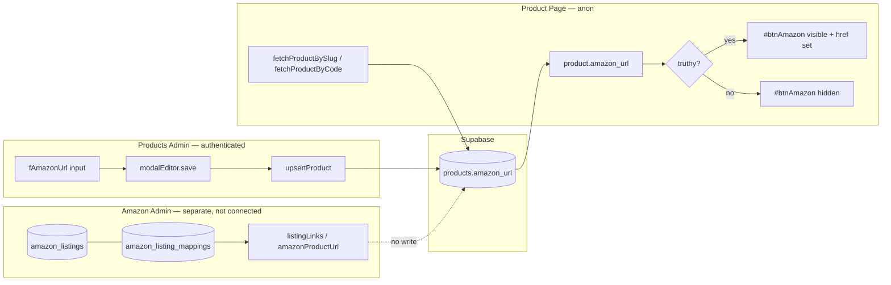

# Current Flow: Product Amazon URL

## Summary

The storefront **Purchase on Amazon** button is driven entirely by a single optional text field on the `products` row: `amazon_url`. There is **no automatic link** between Amazon admin data (`amazon_listings`, `amazon_listing_mappings`, ASIN) and the public product page today. An operator must paste or type the Amazon URL manually in Products admin.

**Related planned work:** [00_storefront_amazon_url_sync_roadmap.md](./flow/00_storefront_amazon_url_sync_roadmap.md)

**Last updated:** 2026-07-08

---

## End-to-end flow (today)



---

## Data model

| Field | Table | Type | Purpose |
|-------|-------|------|---------|
| `amazon_url` | `products` | `TEXT`, nullable | Full Amazon product page URL shown on storefront |

**Migration:** `supabase/migrations/20260108_add_amazon_url_to_products.sql`

- Column comment: *"Optional Amazon product page URL for Buy on Amazon button"*
- No format validation at the DB layer (any string or `NULL`)
- Product-level only — variants do **not** have their own Amazon URL

**Public read contract:** `js/shared/productContract.js` → `PRODUCT_SELECT` includes `amazon_url` alongside other storefront-safe product fields.

**Access:**

- **Anon** can `SELECT` from `products` (including `amazon_url`) — see security grants on `public.products`.
- **Authenticated admin** upserts the full product row via Products admin; `amazon_url` is one field in that payload.

---

## Write path: Products admin

### UI

**Page:** `pages/admin/products.html`

- Field id: `fAmazonUrl`
- Label: **Amazon URL**
- Placeholder: `https://www.amazon.com/dp/...`
- Helper text: *"Optional: Add an Amazon product link to show Buy on Amazon button"*
- Located in the product edit modal basics grid (same section as shipping, supplier link, etc.)

**Wiring:** `js/admin/products/index.js` maps `fAmazonUrl: $("fAmazonUrl")` into modal element refs.

### Load (edit existing product)

`js/admin/products/modalEditor.js` → `openEdit(productId)`:

1. `fetchProductFull(productId)` loads the product via `PRODUCT_SELECT`.
2. Form field: `els.fAmazonUrl.value = full.product.amazon_url || ""`.

### Save

`modalEditor.js` → `save()`:

1. Reads `els.fAmazonUrl.value.trim()`.
2. Empty string becomes `null` in the upsert payload.
3. `upsertProduct(payload)` → `sb.from("products").upsert(payload, { onConflict: "id" })`.
4. No URL shape check, no ASIN extraction, no sync from Amazon tables.

```javascript
amazon_url: els.fAmazonUrl.value.trim() || null,
```

### JSON import / export

The Products admin JSON tools round-trip `amazon_url` for bulk or copy/paste workflows:

| Action | Function | File |
|--------|----------|------|
| Paste JSON into form | `applyJsonToForm` | `modalEditor.js` — sets `fAmazonUrl` when `data.amazon_url` present |
| Copy JSON from form | `buildProductJson` | `modalEditor.js` — includes `amazon_url` in exported object |
| JSON import modal | listener in `index.js` | parses JSON → `applyJsonToForm(els, data)` |

Saving after import follows the same manual `upsertProduct` path as typing in the field.

### What Products admin does **not** do

- Does not read `amazon_listings` or `amazon_listing_mappings`.
- Does not call SP-API.
- Does not build URLs from ASIN (that helper lives in Amazon admin only).
- Does not show Amazon URL in the products table list — only inside the edit modal.

---

## Read path: Storefront product page

### Page markup

**Primary:** `pages/product.html` — `#btnAmazon` is inlined in the purchase column (below Add to Cart).

- Default: `class="hidden"`, `href="#"`, `target="_blank"`, `rel="noopener noreferrer"`
- Styling: Amazon orange (`#FF9900`), label **Purchase on Amazon**

**Legacy duplicate:** `page_inserts/product/details.html` also defines `#btnAmazon`. The live page uses the inlined `product.html` version; `details.html` is not loaded for gallery/details on the current product page.

### JavaScript

**Entry:** `js/product/index.js` → `initProductPage()` on `DOMContentLoaded`.

1. **Resolve product** from URL query:
   - `?slug=...` → `fetchProductBySlug` (lowercased)
   - `?sku=...` → `fetchProductByCode` (uppercased)
2. **Fetch product row** via `js/product/api.js`:
   - `from("products").select(PRODUCT_SELECT).eq(...).eq("is_active", true).single()`
   - Only **active** products are returned to the storefront.
3. **Amazon button** (runs once after product load, not per variant):

```javascript
if (els.amazonBtn) {
  if (product.amazon_url) {
    els.amazonBtn.href = product.amazon_url;
    els.amazonBtn.classList.remove("hidden");
  } else {
    els.amazonBtn.classList.add("hidden");
  }
}
```

**DOM ref:** `js/product/dom.js` → `getProductEls().amazonBtn` = `document.getElementById("btnAmazon")`.

### Storefront behavior rules

| Condition | Button |
|-----------|--------|
| `product.amazon_url` is non-empty string | Visible; `href` = stored URL |
| `product.amazon_url` is `null` / empty | Hidden (`hidden` class) |
| Product inactive | Page errors / not found (product not fetched) |
| Variant selected | **No change** — Amazon link is product-level, not variant-level |
| Listing status on Amazon | **Not consulted** — stale or wrong URLs still show if left in DB |

There is no runtime validation that the URL is an Amazon domain or matches a live ASIN.

---

## Parallel system: Amazon admin (not wired to storefront)

Amazon listing management is a **separate** authenticated admin surface. It maintains its own tables and can construct Amazon URLs from ASIN, but **never writes `products.amazon_url`**.

| Piece | Role |
|-------|------|
| `amazon_listings` | Synced listing rows (ASIN, marketplace, status, etc.) |
| `amazon_listing_mappings` | Links KK `product_id` / `variant_id` to an `amazon_listing_id` |
| `js/admin/amazon/listingLinks.js` | Admin UI links: KK product page, Amazon listing page |
| `js/admin/amazon/listingsExport.js` → `amazonProductUrl(marketplaceId, asin)` | Builds `https://{domain}/dp/{asin}` for US/CA/MX marketplaces |

**Grep confirms:** no references to `amazon_url` under `js/admin/amazon/`.

So today an operator can have a fully mapped, buyable Amazon listing in Amazon admin and still see **no** Purchase on Amazon button on the storefront unless they separately paste the URL into Products admin.

---

## Operational implications

1. **Two sources of truth** — Amazon mapping status (admin) vs. storefront URL (`products.amazon_url`) can drift.
2. **Manual maintenance** — New listings, ASIN changes, or suppressions require someone to update or clear `fAmazonUrl`.
3. **No buyability gate** — A URL stored while a listing was active will keep showing the button even if the Amazon listing is later inactive (until someone clears the field).
4. **Anon-safe by design** — Storefront only reads `products`; no SP-API and no exposure of `amazon_listings` to anonymous clients.
5. **Simple implementation** — Single column, single button, no queue, no edge functions, no triggers on mapping changes.

---

## File reference

| Area | Path |
|------|------|
| DB column | `supabase/migrations/20260108_add_amazon_url_to_products.sql` |
| Shared select list | `js/shared/productContract.js` |
| Products admin HTML | `pages/admin/products.html` |
| Products admin save/load | `js/admin/products/modalEditor.js` |
| Products admin API | `js/admin/products/api.js` |
| Storefront page | `pages/product.html` |
| Storefront logic | `js/product/index.js`, `js/product/api.js`, `js/product/dom.js` |
| Amazon URL builder (admin only) | `js/admin/amazon/listingsExport.js` |
| Amazon admin links | `js/admin/amazon/listingLinks.js` |
| Planned auto-sync | `docs/pages/product/feature/amazonSync/flow/00_storefront_amazon_url_sync_roadmap.md` |

---

## Quick test checklist

1. **Hidden by default** — Product with no `amazon_url` → product page loads, no orange Amazon button.
2. **Manual set** — Products admin → paste `https://www.amazon.com/dp/B0XXXXXXXX` → save → reload product page → button visible, opens correct URL in new tab.
3. **Clear** — Empty `fAmazonUrl`, save → button hidden again.
4. **Inactive product** — `is_active = false` → storefront fetch fails; button never reached.
5. **Mapped but no URL** — Amazon admin shows mapped listing with ASIN → storefront still has no button until `amazon_url` is set manually (documents the gap).
