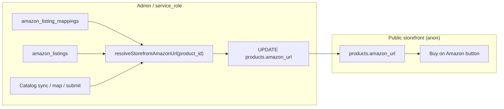

# Progression: Storefront Amazon URL Sync

## Summary

Roadmap to auto-populate `products.amazon_url` from Amazon admin data (mapped listings + ASIN) so the public product page **Buy on Amazon** button stays accurate without manual entry in Products admin or live SP-API calls on the storefront.

**Related todo:** `docs/todoPersonal.md` — **S** Product Amazon URL linked to Amazon listing page automatically  
**Current behavior:** [../CurrentFlow.md](../CurrentFlow.md)  
**Storefront consumer:** `js/product/index.js` (`product.amazon_url` → `#btnAmazon`)  
**Amazon source of truth:** `amazon_listings` + `amazon_listing_mappings` (admin/auth only)  
**URL builder (reuse):** `js/admin/amazon/listingsExport.js` → `amazonProductUrl(marketplace_id, asin)`  
**Last updated:** 2026-07-08

## Overall Status

- [ ] Locked decisions recorded
- [ ] Phase 1 — Resolver + write contract
- [ ] Phase 2 — Sync service + DB updates
- [ ] Phase 3 — Admin trigger hooks
- [ ] Phase 4 — Products admin UX
- [ ] Phase 5 — Backfill, QA, sign-off

---

## Goal

1. **One storefront field** — keep `products.amazon_url` as the public read path (fast, anon-safe, no Amazon API on page load).
2. **Auto-maintained** — write/clear `amazon_url` when Amazon mapping or listing status changes.
3. **No duplicate manual work** — retire (or read-only) the Products editor Amazon URL field.

---

## Locked Decisions (proposed — confirm in Phase 1A)

| # | Decision |
|---|----------|
| 1 | **Do not** call SP-API from the public product page |
| 2 | **Do not** expose `amazon_listings` / mappings to `anon` |
| 3 | **Cache on product** — sync ASIN → `products.amazon_url` server-side or admin-side |
| 4 | **Show button only when** mapped listing has ASIN **and** is buyable (`listing_status_buyable = true`, or `listing_status = 'active'` — pick one in 1A) |
| 5 | **Clear URL when** unmapped, suppressed, no ASIN, or not buyable |
| 6 | **Variation families** — product-level button uses **parent ASIN** when available; else first buyable child ASIN for mapped variant |
| 7 | **Marketplace** — US default (`ATVPDKIKX0DER`); use listing `marketplace_id` for URL domain |
| 8 | **Manual override** — none in v1; Amazon admin is source of truth |

---

## Architecture

**Out of scope**

- Live Amazon inventory/price on product page
- eBay / other marketplace buy buttons (separate effort)
- Changing storefront button styling or placement

---

## Phase 1: Resolver + Write Contract

**Goal:** Define rules and a shared function that returns the correct storefront URL (or `null`) for a KK product — no triggers yet.

### Phase 1A — Rules + data model

- [ ] Document buyable gate (`listing_status_buyable` vs `listing_status = 'active'`)
- [ ] Document variation ASIN precedence (parent → child → variant mapping)
- [ ] Document multi-listing edge case (one mapped buyable listing wins; tie-break by `last_synced_at`)
- [ ] Confirm `products.amazon_url` stays `TEXT`; no new columns in v1
- [ ] Lock decision table above in this doc

### Phase 1B — Shared resolver (read-only)

- [ ] Add `resolveStorefrontAmazonUrl(kk_product_id)` in shared or edge layer (service_role query)
- [ ] Query: `amazon_listing_mappings` (`mapping_status IN ('mapped','legacy')`) join `amazon_listings`
- [ ] Apply buyable + ASIN rules; return `amazonProductUrl(marketplace_id, asin)` or `null`
- [ ] Unit-style verify script or doc table with fixture cases (unmapped, suppressed, parent/child)

**Verification**

- [ ] Resolver returns `null` for unmapped / no ASIN / not buyable
- [ ] Resolver returns correct `https://www.amazon.com/dp/{ASIN}` for happy path

---

## Phase 2: Sync Service + DB Updates

**Goal:** Write or clear `products.amazon_url` from resolver output.

### Phase 2A — Upsert helper

- [ ] Add `syncProductAmazonUrl(kk_product_id)` — calls resolver, `UPDATE products SET amazon_url = …`
- [ ] Clear `amazon_url` when resolver returns `null` (do not leave stale links)
- [ ] Log sync result (product id, old url, new url, reason) for admin debugging
- [ ] Idempotent: safe to call repeatedly

### Phase 2B — Batch sync

- [ ] Add `syncAllMappedProductAmazonUrls()` for catalog sync completion
- [ ] Only touch products with at least one mapping row (mapped/legacy) or previously non-null `amazon_url`
- [ ] Return counts: updated, cleared, unchanged, errors

**Verification**

- [ ] Single-product sync updates DB correctly
- [ ] Batch sync completes without blocking admin UI (async edge or background ok)

---

## Phase 3: Admin Trigger Hooks

**Goal:** Keep `amazon_url` fresh when Amazon admin state changes.

### Phase 3A — Event hooks

- [ ] After **catalog sync** completes → run batch sync (Phase 2B)
- [ ] On **map / unmap** save in Amazon admin → sync affected `kk_product_id`(s)
- [ ] After **live submit + verification** (listing buyable) → sync product from push flow

### Phase 3B — Stale-link safety

- [ ] When listing becomes inactive/suppressed/unmapped → clear product URL on next sync
- [ ] Optional: lightweight nightly repair job (re-run batch sync) — document cron if added

**Verification**

- [ ] Map listing → product page shows button after refresh (no manual URL entry)
- [ ] Unmap / suppress → button hidden after sync

---

## Phase 4: Products Admin UX

**Goal:** Remove duplicate manual Amazon URL entry.

### Phase 4A — Editor field

- [ ] Replace `fAmazonUrl` input with read-only display: **Amazon link (managed by Amazon listings)**
- [ ] Show current `amazon_url` as link + status hint (mapped / not listed / not buyable)
- [ ] Stop persisting `amazon_url` from Products save payload (prevent overwrite)

### Phase 4B — Discoverability

- [ ] Link from Products editor to Amazon admin (mapped listing or Needs Mapping) when product has SKU/code
- [ ] Note in field help: URL updates automatically after Amazon map/sync

**Verification**

- [ ] Saving product details does not wipe auto-synced `amazon_url`
- [ ] Admin can still see whether storefront button will appear

---

## Phase 5: Backfill, QA, Sign-off

**Goal:** Ship for existing catalog and validate storefront.

### Phase 5A — Backfill + rollout

- [ ] One-time script: `syncAllMappedProductAmazonUrls()` against production/staging
- [ ] Report: products updated, cleared, still manual-only (legacy rows to review)
- [ ] Mark todo **S** complete in `docs/todoPersonal.md`

### Phase 5B — QA matrix

- [ ] Storefront: mapped + buyable → button visible, correct ASIN link
- [ ] Storefront: unmapped → button hidden
- [ ] Storefront: mapped but suppressed → button hidden
- [ ] Variation product: parent ASIN link behavior documented and tested
- [ ] Security: anon cannot read `amazon_listings`; only `products.amazon_url`

**Verification**

- [ ] No SP-API calls on `pages/product.html` load
- [ ] Amazon admin remains single operational surface for listing links

---

## File Touch List (expected)

| Area | Files / objects |
|------|-----------------|
| Shared resolver | `supabase/functions/_shared/` or `js/shared/amazonStorefrontUrl.js` + edge caller |
| Sync triggers | Amazon catalog sync function, `js/admin/amazon/` map save, push/verify flow |
| Products admin | `pages/admin/products.html`, `js/admin/products/modalEditor.js` |
| Storefront | `js/product/index.js` (minimal or no change) |
| Backfill | `scripts/supabase/` one-off `.mjs` |
| Docs | this file + optional `01_implementation_notes.md` per phase |

---

## Final Status

- [ ] Roadmap created (5 phases × 2 sub-phases)
- [ ] Phase 1 — Resolver + write contract
- [ ] Phase 2 — Sync service + DB updates
- [ ] Phase 3 — Admin trigger hooks
- [ ] Phase 4 — Products admin UX
- [ ] Phase 5 — Backfill, QA, sign-off
