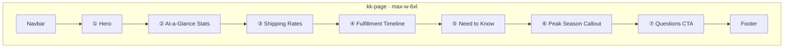

# Progression: Shipping Page Visual Overhaul (7826)

## Summary

Roadmap to redesign `/pages/shipping.html` to match `.cursor/rules/website-theme.mdc`, replace outdated copy with audited shipping facts, and load the live free-shipping threshold from `site_settings` via page JS (`.cursor/rules/js-file-structure.mdc`).

**Baseline visual doc:** `docs/pages/shipping/ux/currentUX.md`  
**Target page:** `pages/shipping.html`  
**Theme reference:** `.cursor/rules/website-theme.mdc`  
**JS structure reference:** `.cursor/rules/js-file-structure.mdc`  
**Last updated:** 2026-07-08

## Overall Status

- [x] Current visual UX documented
- [x] Site-wide shipping copy audit completed
- [x] Product decisions locked (see below)
- [x] Phase 1 — Foundation
- [x] Phase 2 — Hero + stats
- [x] Phase 3 — Shipping rates
- [x] Phase 4 — Timeline + need to know
- [x] Phase 5 — Callouts, CTA, QA

---

## Goal

Deliver a **pure informational** shipping page that:

1. Matches KK storefront visuals (black borders, heavy uppercase type, pink accents, `max-w-6xl`).
2. States **how karrykraze.com shipping actually works** — rates, timelines, regions, SMS tracking.
3. Loads the **live free-shipping threshold** from admin settings (no hardcoded $50 in copy).

---

## Locked Decisions

| # | Decision |
|---|----------|
| 1 | **Live threshold** — fetch from `site_settings.free_shipping` via page JS |
| 2 | **Backorder / MTO** — include dedicated callout (3–4 weeks) |
| 3 | **Tracking alerts** — say **SMS** (shipped + delivered) |
| 4 | **Carrier** — **USPS** (generic; service level varies at fulfillment) |
| 5 | **Express label** — **Express Shipping** (matches Stripe/checkout) |
| 6 | **Scope** — **shipping page only** (no FAQ edits in this effort) |
| 7 | **Layout width** — **`max-w-6xl`** per `websiteTheme.md` |
| 8 | **Returns** — **no returns content** on this page; refunds policy lives elsewhere (FAQ / Contact) |

---

## Scope

- [x] Visual reskin of `pages/shipping.html`
- [x] Accurate static + dynamic copy
- [x] New `js/pages/shipping/` module tree
- [x] Live free-shipping threshold injection
- [ ] CTA links: Contact, FAQ, My Orders

## Out of Scope

- [ ] `pages/faq.html` shipping copy fixes
- [ ] Returns page or return-shipping workflow
- [ ] Checkout / Shippo / Stripe rate changes
- [ ] Tracking lookup UI on this page
- [ ] Admin settings UI changes

---

## Content Source (Audited Facts)

| Topic | Customer-facing fact |
|-------|----------------------|
| Region | United States only |
| Standard | **$8.95** |
| Express Shipping | **$12.99** |
| Free shipping | **$0** when subtotal ≥ live threshold **or** free-shipping promo/coupon |
| Standard / free transit | **5–7 business days** (after ship) |
| Express transit | **2–3 business days** (after ship) |
| In-stock ship-out | **1–2 business days** |
| Backorder / MTO | **3–4 weeks** |
| Carrier | **USPS** |
| Tracking | **My Orders** lookup + **SMS** on shipped/delivered |
| Address | Verify in Stripe checkout; changes not guaranteed after order |

**Replace from current page:** always-free standard, 1–3 / 7–14 day windows, Ground Advantage naming, email tracking, “100% trackable” stat.

---

## Target Visual Sitemap



Sections separated by `border-t-4 border-black` dividers. All content cards use `border-4 border-black` + offset shadow per theme.

---

## JS Module Plan

Per `jsFileStructure.md` — single HTML script tag, logic split by section:

```
js/pages/shipping/
  index.js                 ← entry: DOMContentLoaded, navbar/footer, orchestration
  state/
    constants.js           ← rates ($8.95, $12.99), windows, static labels
  render/
    stats.js               ← ② stat grid; inject live threshold into FREE tile
    rates.js               ← ③ rate cards; threshold qualifier line
    needToKnow.js          ← ⑤ optional threshold line in free-shipping tile
  ui/
    freeShippingSettings.js ← wrap shared getFreeShippingSettings(); format $ threshold
```

**Reuse:** `getFreeShippingSettings()` from `js/shared/cart/freeShippingBar.js` (no duplicate Supabase fetch logic).

**HTML import:**

```html
<script type="module" src="/js/pages/shipping/index.js"></script>
```

**Dynamic copy targets** (elements with `data-shipping-threshold` or IDs):

- Stat tile sublabel: `Orders $XX+`
- Free Shipping rate card qualifier
- Need to Know → free shipping threshold tile

**Fallback if settings fail or `enabled: false`:** show default threshold **$50** in copy and note that promotions may apply; stat tile shows threshold value without implying active promo.

---

## Phase 1: Foundation

**Goal:** Page shell, theme tokens, and JS scaffold — no section content yet.

**Status:** - [x] Complete (2026-07-08)

### Phase 1A — HTML shell + theme

- [x] Add `body class="kk-page bg-gray-50 min-h-screen flex flex-col"`
- [x] Set `main` to `flex-1 max-w-6xl mx-auto px-4 py-8 sm:py-12 w-full`
- [x] Extend Tailwind: `borderWidth: { '4': '4px' }`, `kkpink`, `kkpeach`
- [x] Keep `#kkNavbarMount` / `#kkFooterMount`
- [x] Remove inline page script block; add module entry for `js/pages/shipping/index.js`
- [x] Remove legacy `.info-card` / pastel timeline inline CSS

### Phase 1B — JS scaffold

- [x] Create `js/pages/shipping/index.js` (navbar, footer, call section inits)
- [x] Create `state/constants.js` (rates, delivery windows, backorder weeks)
- [x] Create `ui/freeShippingSettings.js` (load + format threshold)
- [x] Verify module loads with no console errors on GitHub Pages base path

**Verification:**

- [x] Page loads with navbar/footer only; no regressions to mounts
- [x] `index.js` stays under 500 lines

---

## Phase 2: Hero + At-a-Glance Stats

**Goal:** Section ① hero and ② stats grid — branded layout + live threshold in stats.

**Status:** - [x] Complete (2026-07-08)

### Phase 2A — Hero section

- [x] Black kicker badge: `Shipping`
- [x] H1: `How Shipping Works` — `font-black text-3xl sm:text-4xl tracking-tight`
- [x] Subtitle: `text-sm text-gray-500`
- [x] `border-t-4 border-black` divider below hero block

### Phase 2B — Stats grid + dynamic threshold

- [x] `grid grid-cols-2 md:grid-cols-4 gap-4` — four `border-4 border-black` stat tiles
- [x] Tiles: `$8.95` Standard · `FREE` / `Orders $XX+` · `1–2` Ship-Out Days · `US` Shipping Only
- [x] `render/stats.js` — fetch settings, write threshold into `FREE` sublabel
- [x] Stat values use `font-black text-2xl sm:text-3xl`; labels `text-[11px] font-black uppercase tracking-[.12em] text-black/70`

**Verification:**

- [x] Changing admin threshold updates stat sublabel after refresh
- [x] Mobile 2×2 grid; desktop 1×4 row

---

## Phase 3: Shipping Rates

**Goal:** Section ③ — three rate cards with accurate prices and transit windows.

**Status:** - [x] Complete (2026-07-08)

### Phase 3A — Rate cards (static structure)

- [x] Section title with pink squiggle underline: `Shipping Rates`
- [x] Three stacked `border-4 border-black` cards:
  - **Free Shipping** — $0 · 5–7 business days
  - **Standard Shipping** — $8.95 · 5–7 business days · USPS
  - **Express Shipping** — $12.99 · 2–3 business days · USPS
- [x] Chip badges: `FREE`, `STANDARD`, `EXPRESS` (black or `.kk-chip` pattern)
- [x] Card layout: title row + price + estimate; body `text-sm text-gray-600`

### Phase 3B — Dynamic threshold copy + footnote

- [x] `render/rates.js` — inject live threshold into Free Shipping qualifier (`Orders $XX+ before shipping…`)
- [x] Footnote below cards: *Delivery estimates are in business days and start after your order ships.*
- [x] `border-t-4 border-black` divider below section

**Verification:**

- [x] Prices match `create-checkout-session` ($8.95 / $12.99 / $0)
- [x] Free card threshold matches admin setting

---

## Phase 4: Timeline + Need to Know

**Goal:** Sections ④ fulfillment timeline and ⑤ policy grid.

**Status:** - [x] Complete (2026-07-08)

### Phase 4A — Fulfillment timeline

- [x] Section title: `Fulfillment Timeline` + squiggle
- [x] Single `border-4 border-black` card; vertical timeline (black dots + 1px black/gray line)
- [x] Five steps:
  1. Order placed — checkout confirmation
  2. Processing — in stock **1–2 business days**; backorder/MTO **3–4 weeks**
  3. Shipped — USPS label; tracking on order
  4. In transit — **5–7** days (standard/free) or **2–3** days (Express Shipping)
  5. Delivered — **SMS** notification

### Phase 4B — Need to know grid

- [x] Section title: `Need to Know` + squiggle
- [x] `grid md:grid-cols-2 gap-4` — six `border-4 border-black` tiles:
  - United States only
  - Free shipping threshold (dynamic `Orders $XX+`)
  - Backorders / MTO (3–4 weeks)
  - Tracking (My Orders + **SMS**)
  - Shipping address (verify at checkout)
  - Business days (Mon–Fri, excl. holidays)
- [x] `render/needToKnow.js` — threshold injection on free-shipping tile
- [x] `border-t-4 border-black` divider below section

**Verification:**

- [x] Backorder callout present
- [x] No returns / return-shipping copy anywhere
- [x] SMS mentioned; email tracking not claimed

---

## Phase 5: Callouts, CTA, QA

**Goal:** Sections ⑥⑦, final polish, and sign-off.

**Status:** - [x] Complete (2026-07-08)

### Phase 5A — Peak season + questions CTA

- [x] Peak season callout — `border-4 border-black` or yellow skew badge header; 1–2 extra processing days during holidays/sales
- [x] CTA card — `border-4 border-black bg-black text-white` or inverted white card per theme
- [x] H2: `Have Questions?`
- [x] Buttons (KK pattern — `border-4 border-black font-black uppercase`):
  - Contact Us → `contact.html`
  - View FAQ → `faq.html`
  - My Orders → `my-orders.html`
- [x] **No** Returns / Refunds link on this page

### Phase 5B — Visual QA + doc update

- [x] Desktop + mobile pass against `websiteTheme.md` (borders, type, kkpink hover, `max-w-6xl`)
- [x] Live threshold test with admin settings change
- [x] Focus-visible pink outline on interactive elements
- [x] Update `currentUX.md` after ship (optional follow-up doc task)

**Verification:**

- [x] Informational only — no forms, calculators, or tracking lookup
- [x] All section dividers and card borders consistent
- [x] Links resolve from `/pages/` directory

---

## Copy Quick Reference (Implementation)

### Hero

- Kicker: `Shipping`
- H1: `How Shipping Works`
- Subtitle: `Rates, timelines, and tracking for karrykraze.com orders.`

### CTA subtext

`We're here to help with any shipping questions.`

---

## Remaining Question

1. **Free shipping disabled in admin** — **Resolved: (A)** — still show threshold; use “when promo active” wording via `loadFreeShippingDisplay()`.

---

## Final Status

- [x] Roadmap restructured (5 phases × 2 sub-phases)
- [x] User decisions recorded
- [x] Remaining question answered (default A)
- [x] Phase 1 implemented
- [x] Phase 2 implemented
- [x] Phase 3 implemented
- [x] Phase 4 implemented
- [x] Phase 5 implemented — **7826 visual overhaul complete**
