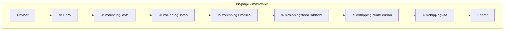

# Shipping Page — Current Visual UX

## Summary

Visual structure reference for `/pages/shipping.html` after the **7826 visual overhaul** (complete).

**Source:** `pages/shipping.html`, `js/pages/shipping/`  
**Roadmap:** `docs/pages/shipping/ux/7826/00_visual_overhaul_roadmap.md`  
**Theme reference:** `.cursor/rules/website-theme.mdc`  
**Last documented:** 2026-07-08 (Phase 5 complete)

## Implementation Status

| Phase | Status |
|-------|--------|
| 1 — Foundation | **Complete** |
| 2 — Hero + stats | **Complete** |
| 3 — Shipping rates | **Complete** |
| 4 — Timeline + need to know | **Complete** |
| 5 — Callouts + CTA | **Complete** |

---

## Visual Sitemap (Live)



---

## Page Shell

| Layer | Spec |
|-------|------|
| `body` | `kk-page bg-gray-50 text-gray-800 min-h-screen flex flex-col` |
| Main | `#shippingMain` — `max-w-6xl mx-auto px-4 py-8 sm:py-12` |
| Script | `/js/pages/shipping/index.js` (single module entry) |

---

## Section ① — Hero

| Element | Content |
|---------|---------|
| Kicker | `Shipping` (black badge) |
| H1 | `How Shipping Works` |
| Subtitle | Rates, timelines, and tracking for karrykraze.com orders |
| Divider | `border-t-4 border-black mb-8` |

---

## Section ② — At-a-Glance Stats

**Mount:** `#shippingStats` · `render/stats.js`

| Tile | Value | Label |
|------|-------|-------|
| 1 | $8.95 | Standard |
| 2 | FREE (kkpink) | Orders $XX+ (live) |
| 3 | 1–2 | Ship-Out Days |
| 4 | US | Shipping Only |

**Grid:** `grid-cols-2 md:grid-cols-4` · `border-4 border-black` tiles

---

## Section ③ — Shipping Rates

**Mount:** `#shippingRates` · `render/rates.js`

- Squiggle heading: **Shipping Rates**
- Three cards: Free ($0) · Standard ($8.95) · Express Shipping ($12.99)
- Free card qualifier uses live admin threshold
- Footnote on business-day estimates
- Bottom `border-t-4` divider

---

## Section ④ — Fulfillment Timeline

**Mount:** `#shippingTimeline` · `render/timeline.js`

- Squiggle heading: **Fulfillment Timeline**
- Single timeline card, 5 steps (Order → Processing → Shipped → In Transit → Delivered SMS)

---

## Section ⑤ — Need to Know

**Mount:** `#shippingNeedToKnow` · `render/needToKnow.js`

- Squiggle heading: **Need to Know**
- Six tiles (2×2 on md+): US only, free threshold, backorder/MTO, tracking + SMS, address, business days
- My Orders link with kkpink focus ring
- Bottom `border-t-4` divider

---

## Section ⑥ — Peak Season (Live)

**Mount:** `#shippingPeakSeason` · `render/callouts.js`

| Element | Spec |
|---------|------|
| Card | `border-4 border-black bg-white` + offset shadow |
| Badge | Yellow skew header `Peak Seasons` (`bg-yellow-400 -skew-x-6`) |
| Title | `Possible Delays` — uppercase black |
| Body | Extra 1–2 business days during holidays/sales; SMS updates |

**Spacing:** `pt-8 mb-8` (after need-to-know divider)

---

## Section ⑦ — Questions CTA (Live)

**Mount:** `#shippingCta` · `render/callouts.js`

| Element | Spec |
|---------|------|
| Card | `border-4 border-black bg-black text-white` |
| H2 | `Have Questions?` |
| Subtext | `We're here to help with any shipping questions.` |
| Buttons | Contact Us · View FAQ · My Orders |

**Button pattern:**

- Primary: white fill, `hover:bg-kkpink`
- Secondary: white outline, `hover:bg-white hover:text-black`
- All: `font-black uppercase`, `focus-visible:outline-kkpink`

**Links:** `contact.html`, `faq.html`, `my-orders.html` (relative `/pages/` paths)

**Excluded:** No Returns / Refunds link

---

## JavaScript Modules

```
js/pages/shipping/
  index.js
  state/constants.js
  ui/freeShippingSettings.js
  utils/sectionHeading.js
  render/
    stats.js
    rates.js
    timeline.js
    needToKnow.js
    callouts.js
```

### Init order

1. Navbar + footer
2. Load free-shipping display (live threshold)
3. Render stats → rates → timeline → need to know → peak season → CTA

---

## Dynamic Content

| Surface | Source |
|---------|--------|
| FREE stat sublabel | `site_settings.free_shipping.threshold` |
| Free rate qualifier | Same + enabled/disabled copy (decision A) |
| Free threshold tile | Same |

**Fallback:** $50 if settings fail

---

## Final Status

- [x] All 7 sections live
- [x] KK theme applied (`max-w-6xl`, 4px borders, font-black, kkpink accents)
- [x] Informational only — no forms or tracking lookup
- [x] 7826 visual overhaul complete
